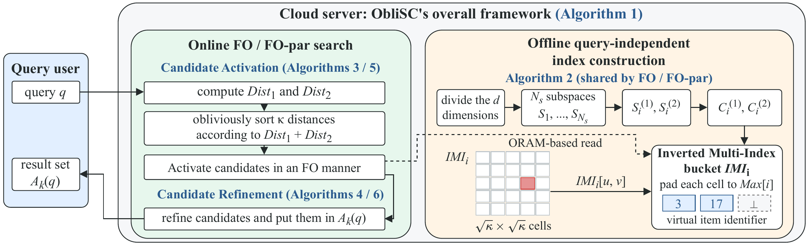

# ObliSC: FO and FO-par

ObliSC is a subspace-collision search framework. This C++17 source release
provides its fixed-budget search base, **ObliSC-FO**, and parallel implementation,
**ObliSC-FO-par**. Both use the same public padded index, candidate budgets,
collision scores, refinement count, and deterministic tie rules.

This directory contains only the two search implementations, shared utilities,
build configuration, and tests. It does not include competing methods, datasets,
generated indexes, experiment logs, server credentials, or deployment machinery.

## Framework Overview



ObliSC separates offline index preparation from online query processing.
ObliSC-FO and ObliSC-FO-par share the same index and search stages:

1. **Shared index.** Load the pretrained centroids and assignments, organize
   items into subspace IMI cells, and pad each cell to its subspace's capacity.
2. **Candidate activation.** Project the query, order cells by centroid-pair
   distance, and scan a fixed number of cells per subspace. Items receive
   collision votes from the visited cells.
3. **Refinement.** Select candidates by collision score and activation rank,
   evaluate their distances to the query, and return the top-k results with
   deterministic ID tie breaking.

ObliSC-FO processes a query's subspaces sequentially. ObliSC-FO-par parallelizes
subspace processing, voting, candidate selection, and distance evaluation. With
identical inputs and parameters, parallel execution preserves the ordered results; it
changes the execution schedule, not the index or search budgets. The packaged
backend and its security limitations are described under **Implementation Scope**.

## Build

Requirements: a C++17 compiler, CMake >= 3.16, and OpenMP. Python 3 is optional
for the CLI smoke test and toy example; neither search executable depends on it.

```bash
cmake -S . -B build -DCMAKE_BUILD_TYPE=Release
cmake --build build --parallel 8
ctest --test-dir build --output-on-failure
```

This produces `build/ppsc_fo` and `build/ppsc_fo_par`. Use
`-DPPSC_NATIVE=ON` when building on the benchmark machine to enable native CPU
instructions, including AVX2 where available. Do not move native binaries to
machines with a different instruction set. No fast-math option is enabled.

On macOS, install an OpenMP runtime and point CMake to it if necessary:

```bash
cmake -S . -B build -DCMAKE_BUILD_TYPE=Release \
  -DOpenMP_CXX_FLAGS="-Xpreprocessor -fopenmp" \
  -DOpenMP_CXX_LIB_NAMES=omp \
  -DOpenMP_omp_LIBRARY=/path/to/lib/libomp.dylib \
  -DCMAKE_CXX_FLAGS="-I/path/to/include"
```

## Layout

```text
CMakeLists.txt
LICENSE
README.md
assets/framework.png              ObliSC framework overview
include/oblisc/oblisc.hpp
src/algorithm1_framework.cpp       ObliSC-FO batch execution
src/algorithm2_index_construct.cpp shared index loading and padding
src/algorithm3_fo_canactive.cpp    ObliSC-FO candidate activation
src/algorithm4_fo_topk_refine.cpp  ObliSC-FO refinement
src/parallel/                    ObliSC-FO-par execution, activation, refinement
src/dataset.cpp                  data I/O and runtime audit
src/fo_primitives.cpp             retained legacy primitive helpers
src/metrics.cpp                  recall@k
src/run_benchmark.cpp             common command-line interface
scripts/make_demo.py              deterministic toy inputs and index
tests/                           equivalence and CLI regression tests
```

## Inputs and Offline Index

Files have no row headers. Use the same byte order as the machine running the
benchmark (little-endian for the evaluated x86 servers).

* Base and query files: row-major `float32`, with `N*D` and `Q*D` elements.
* Ground truth: row-major `int64`, with `Q*k` zero-based item identifiers.
* Public index: the centroid/assignment format consumed by the original ObliSC-FO
  pipeline. It starts with `Ns*2*C*(subspace_dim/2)` `float32` centroids, followed
  by `Ns*2*N` `int32` assignments. For each subspace, assignments for the first
  half precede those for the second half; centroids follow the same order.

`--suco-index-path` is required. The shared index routine loads this public
centroid/assignment file and materializes equal-capacity padded cells for each
subspace. It does **not** train K-means. For real datasets, supply the index
from the original SuCo preprocessing/index-construction stage, using matching
dimensions, centroids, SRHT setting, and seed 42. The external SuCo trainer and
its third-party dependencies are not bundled here. This package is not a new
index-training implementation.

The optional `--upstream-index-ms` must be an actual recorded training time.
The reported index time is that supplied time plus newly measured padding
materialization; a zero or omitted training time does not mean that K-means
training was measured. Index reuse is not a new measurement of offline training.

## Quick Functional Example

The toy fixture is for installation checks, not performance claims or paper
results. It creates known centroid assignments without training a model.

```bash
python3 scripts/make_demo.py --out data/demo
mkdir -p results
./build/ppsc_fo \
  --dataset-path data/demo/base.f32 --query-path data/demo/query.f32 \
  --groundtruth-path data/demo/gt.i64 --suco-index-path data/demo/index.bin \
  --dataset-size 64 --query-size 4 --dim 8 --k 5 --subspace-num 2 \
  --kmeans-num-centroid 2 --sc-fixed-cells 4 --beta 1 \
  --use-srht false --path-oram false --threads 8 \
  --output-path results/fo.ids --audit-path results/fo.audit
./build/ppsc_fo_par \
  --dataset-path data/demo/base.f32 --query-path data/demo/query.f32 \
  --groundtruth-path data/demo/gt.i64 --suco-index-path data/demo/index.bin \
  --dataset-size 64 --query-size 4 --dim 8 --k 5 --subspace-num 2 \
  --kmeans-num-centroid 2 --sc-fixed-cells 4 --beta 1 \
  --use-srht false --path-oram false --threads 8 --workers-per-subspace 2 \
  --output-path results/par.ids --audit-path results/par.audit
diff results/fo.ids results/par.ids
```

For real data, replace the paths and shape arguments with the matching files.
Reference defaults are `k=50`, `Ns=8`, `C=50`, `t=2`, `alpha=0.03`,
`beta=0.003`, fixed `hat-alpha=100`, and SRHT enabled. Dataset-specific
configurations must be passed explicitly and identically to both executables;
these generic defaults are not a claim that every historical experiment used
the same settings. `--sc-fixed-cells` is the fixed activation-cell budget.

## Parallelism and Timing

* `--threads T` sets the total worker budget, capped at 100. Default: 1, or
  `PPSC_NUM_THREADS` if supplied. Set it explicitly for comparisons.
* ObliSC-FO processes queries concurrently but runs each query's subspaces in sequence.
* ObliSC-FO-par uses `--workers-per-subspace p` (default 2, supported 1 through 5).
  A query uses `Ns*p` workers, and the default number of concurrent query groups
  is `min(Q, floor(T/(Ns*p)))`. `Ns*p` must fit within `T`.
* `--query-groups G` optionally reduces the number of concurrent ObliSC-FO-par queries;
  it cannot increase the total thread budget. Zero selects the default.

For batch comparisons, keep inputs, budgets, thread limit, warmup protocol,
compiler, and CPU binding identical. Example OpenMP settings on Linux:

```bash
export OMP_THREAD_LIMIT=100 OMP_DYNAMIC=FALSE OMP_MAX_ACTIVE_LEVELS=3
export OMP_PROC_BIND=spread,spread,close OMP_PLACES=threads
```

`average query time` is batch wall time divided by query count. `average query
latency` is the mean duration of concurrently processed individual queries;
these are different quantities. Stage timings are per-query latency components,
not additive components of amortized batch time. Output IDs are text, one
ordered top-k row per query. Audits are `key=value` text files.

Candidate order is collision score descending, earliest activation rank
ascending, then item ID ascending. Final ranking is squared Euclidean distance
ascending, then ID ascending. For angular retrieval, normalize both base and
query vectors consistently before indexing and searching.

## Implementation Scope

The packaged benchmark executables explicitly use **direct memory**, and reject
`--path-oram true`. Retained legacy helpers and their counter tests are not a
payload-protecting backend. Heap selection, direct score updates, and conditional
dummy handling do not establish access-pattern privacy. Audit fields explicitly
record `access_pattern_protection=false` and `privacy_verified=false`; legacy
fixed-shape or sort counters are instrumentation, not a security certificate.
SEV capability checks also do not establish that a run is inside an attested TEE.

The sequential ObliSC-FO core is retained from the legacy source snapshot;
ObliSC-FO-par uses the validated packed score/min-rank voting and exact heap
selection path, with optional grouped centroid-distance/cell-sort workers. Packaging adds typed
parallel options, safe direct-memory defaults, input checks, and audit labels;
it does not replace the search kernels or claim to recreate historical table
measurements. Regression tests check ordered candidates and final IDs against
the ObliSC-FO core for all five worker-group sizes, including ties and padding.
